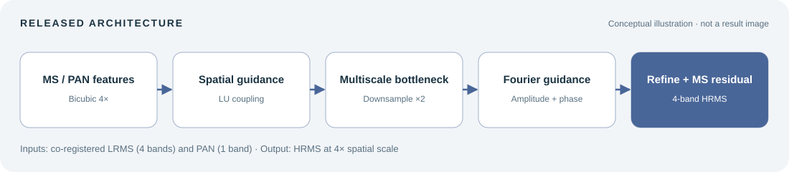

<div align="center">

# MSDDN

### Multiscale Dual-Domain Guidance Network for Pan-Sharpening

**IEEE TGRS · 2023 · Official research implementation**

Xuanhua He, Keyu Yan, Jie Zhang, Rui Li, Chengjun Xie, Man Zhou, Danfeng Hong

[Paper](https://doi.org/10.1109/TGRS.2023.3273334) · [Modern implementation](modern/README.md) · [Project website source](docs/) · [Compatibility CI](https://github.com/alexhe101/MSDDN/actions/runs/45547411741)

[](https://github.com/alexhe101/MSDDN/actions/workflows/modern-pytorch.yml)

</div>



## Overview

A multiscale U-shaped network combining local spatial guidance and global Fourier-domain guidance. It uses invertible coupling during spatial fusion and amplitude/phase fusion during reconstruction.

## Compatibility-first release

The new standalone package under `modern/` is derived from the exact public release, not a new architecture. The original implementation and experiment configuration are retained.

- Isolate spatial coupling, LU mixing, Fourier fusion and reconstruction.
- Preserve original spatial/frequency guidance order, FFT normalization, rfft2/irfft2, amplitude/phase operations, epsilon placement and final magnitude.
- Keep all registered parameters, including inactive tensors. LU masks/identity become non-persistent buffers so they follow module.to() without changing checkpoint keys or performing repeated device transfers.
- Preserve the released CALayer implementation, including its pooled-residual behavior; do not replace it with a different attention block.

## Quick start

```bash
git clone https://github.com/alexhe101/MSDDN.git
cd MSDDN
git switch refactor/modern-pytorch
```


```bash
python -m pip install -e './modern[dev]'
python -m pytest modern/tests -v -rs
```

```python
from msddn import build_model, load_weights, predict
import torch

model = build_model(device="cpu").eval()
load_weights(model, "your_checkpoint.pth")
ms = torch.rand(1, 4, 32, 32, device="cpu")
pan = torch.rand(1, 1, 128, 128, device="cpu")
with torch.inference_mode():
    hrms = predict(model, ms, pan)
```

The above uses random inputs for an API demonstration only. Follow [data and radiometry conventions](modern/README.md#input-and-output-contract) for real data.

```bash
msddn infer --device cpu --checkpoint your_checkpoint.pth --input scene.npz --output result.npz
msddn train --device cpu --data paired_train --output runs/train
```

## Weights and reproducibility

The state dict names and shapes remain the same as the released `Net`. The strict loader handles bare weights or the original `net` wrapper and an all-keys DataParallel prefix. Unused registered tensors are deliberately retained. The repository does not contain public trained checkpoints. Tests use the actual released model's initialized weights, not recovered pretrained weights.


## Research results

| Dataset | PSNR ↑ | SSIM ↑ | SAM ↓ | ERGAS ↓ |
|:--|--:|--:|--:|--:|
| WorldView-II | 41.8435 | 0.9711 | 0.0222 | 0.9478 |
| Gaofen-2 | 47.4101 | 0.9895 | 0.0101 | 0.5414 |
| WorldView-III | 30.8645 | 0.9258 | 0.0757 | 2.9581 |

MSDDN comparison row in the later Pan-Mamba preprint v2, Table 1. These are secondary published benchmark values, not the original MSDDN paper table or a new reproduction.

[Original result source](https://arxiv.org/html/2402.12192v2#S4)

## Validation and scope

The suite compares the refactored model against the actual published source at width 4 and width 32: state-dict keys, strict loading, outputs, input gradients and every active parameter gradient. FFT and coupling computations are compared without replacing their operators. It also checks the CLI and one-step synthetic training. These are regression tests on synthetic inputs; they are not remeasurements of the paper's dataset quality.

[CI record](https://github.com/alexhe101/MSDDN/actions/runs/45547411741). Full dataset reproduction and GPU performance are not claimed by the refactor.

## Repository layout

| Path | Purpose |
|:--|:--|
| [modern/src/msddn/](modern/src/msddn/) | Modular implementation |
| [modern/tests/](modern/tests/) | Release and checkpoint regression |
| [modern/README.md](modern/README.md) | Installation, data, compatibility details |
| [model/msddn.py](model/msddn.py) | Untouched original model |
| [option.yml](option.yml) | Untouched original training configuration |
| [docs/](docs/) | Static project website |

The legacy training entry point is `main.py`; the original testing script is `test.py`. Configure paths and the historical dependencies before using them. The original training data are not distributed.

## Citation

```bibtex
@article{he2023msddn,
  title = {Multiscale Dual-Domain Guidance Network for Pan-Sharpening},
  author = {He, Xuanhua and Yan, Keyu and Zhang, Jie and Li, Rui and Xie, Chengjun and Zhou, Man and Hong, Danfeng},
  journal = {IEEE Transactions on Geoscience and Remote Sensing},
  volume = {61},
  pages = {1--13},
  year = {2023},
  doi = {10.1109/TGRS.2023.3273334}
}
```
